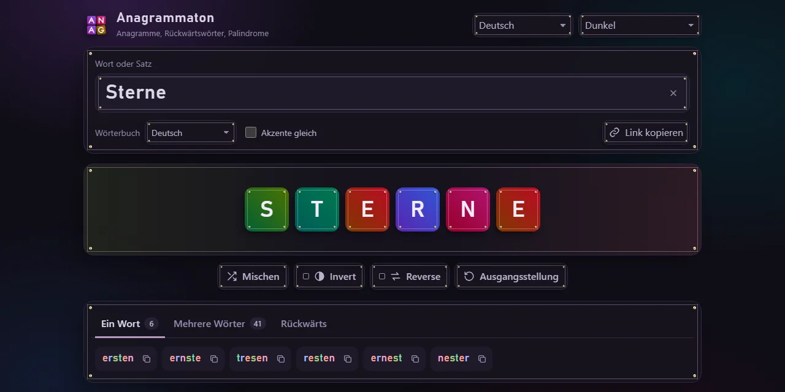

# Anagrammaton

**Anagramme, Rückwärtswörter und Palindrome in 14 Sprachen, ohne Werbung und ohne Cookies.** Jeder Buchstabe ist eine farbige Kachel, die beim Umstellen an ihren neuen Platz fliegt. Weil die Farbe am Buchstaben hängt, siehst du genau, wohin jedes R und jedes E wandert. Läuft im Browser und nach dem ersten Besuch auch offline.

   

**Live:** https://dennismit2n.github.io/anagrammaton/ · [English version](README.md)

## Was es kann

| | |
|---|---|
| **Ein Wort** | Alle Wörter aus genau denselben Buchstaben: aus „Lager“ wird „Regal“, aus „listen“ „silent“, „enlist“ und „tinsel“. |
| **Mehrere Wörter** | Ganze Sätze umstellen, mit Grenzen für Wortzahl und Mindestlänge und einem Wort, das vorkommen muss. Die geläufigsten Treffer stehen oben. |
| **Rückwärts** | Rückwärtsfassung, Palindrom-Urteil („Ein Esel lese nie“) und Rückwärtswörter wie Lager und Regal. Dazu eine Liste zum Entdecken je Sprache. |
| **Die Bühne** | Jede Einheit ist eine Kachel mit fester Farbe. Ein Klick auf einen Treffer, und die Kacheln fliegen in die neue Reihenfolge. |
| **Mischen, Invert, Reverse** | Mischen würfelt die Kacheln neu. Invert kippt jede Farbe in ihre Gegenfarbe. Reverse dreht die Reihenfolge um und lässt den Farbverlauf rückwärts laufen. |
| **Alle Schriften** | Gezählt werden Graphem-Einheiten: Buchstaben in Latein und Kyrillisch, Akshara in Hindi, Silbenblöcke in Koreanisch, Zeichen in Chinesisch und Japanisch (蜂蜜 und 蜜蜂, 会社 und 社会). |
| **Teilen** | Der Link merkt sich Wort, Sprache, Invert und Reverse. Jeder Treffer lässt sich kopieren. |

## Wörterbücher

Die Wortlisten kommen aus [wordfreq](https://github.com/rspeer/wordfreq) von Robyn Speer, also aus Häufigkeitslisten echter Texte. Darum stehen auch Namen und seltene Formen drin. Schimpfwörter habe ich mit der Liste [LDNOOBW](https://github.com/LDNOOBW/List-of-Dirty-Naughty-Obscene-and-Otherwise-Bad-Words) herausgefiltert. Je Sprache sind es 23.000 bis 69.000 Wörter. Quellen und Lizenzen stehen in [woerter/LIZENZ.md](woerter/LIZENZ.md), das Bauskript in `tools/woerter.py`.

## Datenschutz

- Kein Konto, keine Werbung, keine Cookies, keine Schriften oder Skripte von fremden Seiten.
- Die Content Security Policy erlaubt Anfragen nur an die eigene Adresse. Geladen wird nur das Wörterbuch der gewählten Sprache.
- Das Wort steht im Link, nicht auf deinem Gerät. Gespeichert werden nur Sprache und Darstellung.

## Installieren und offline

Ein Service Worker hält die Seite und jedes Wörterbuch, das du schon benutzt hast, auch ohne Verbindung bereit. In Chrome, Edge und Samsung Internet erscheint oben ein Knopf „Installieren“. Auf dem iPhone geht das in Safari über „Zum Home-Bildschirm“.

## Darstellung und Sprachen

Dunkel als Grundzustand, dazu Hell, zwei Modi mit hohem Kontrast, zwei für Farbenblinde und umgekehrte Farben, gemeinsam mit den anderen Werkzeugen der Werkstatt. Bewegung ist ruhig, ohne Blinken, und fällt weg, wenn dein System weniger Bewegung wünscht. Deutsch, Englisch, Spanisch, Französisch, Italienisch, Niederländisch, Polnisch, Portugiesisch, Türkisch, Russisch, Hindi, Chinesisch, Japanisch und Koreanisch. Einige Übersetzungen sind maschinell, Korrekturen nehme ich gern an.

## Entwicklung

Kein Bauschritt, keine Abhängigkeiten. `index.html` enthält Oberfläche, Stile und Texte, `engine.js` die Anagramm-Rechnung (läuft im Browser-Worker und in Node), `worker.js` lädt das Wörterbuch und sucht im Hintergrund. Tests: `node --test tests/`. In `tools/` liegen das Bauskript der Wortlisten, das Icon-Skript und ein Playwright-Test für alle 14 Sprachen.

## Lizenz

Code: [MIT](LICENSE). Wortlisten: CC BY-SA 4.0, siehe [woerter/LIZENZ.md](woerter/LIZENZ.md).

© 2026 Dennis_mit_2n · Teil der [Werkstatt](https://dennismit2n.github.io/)
