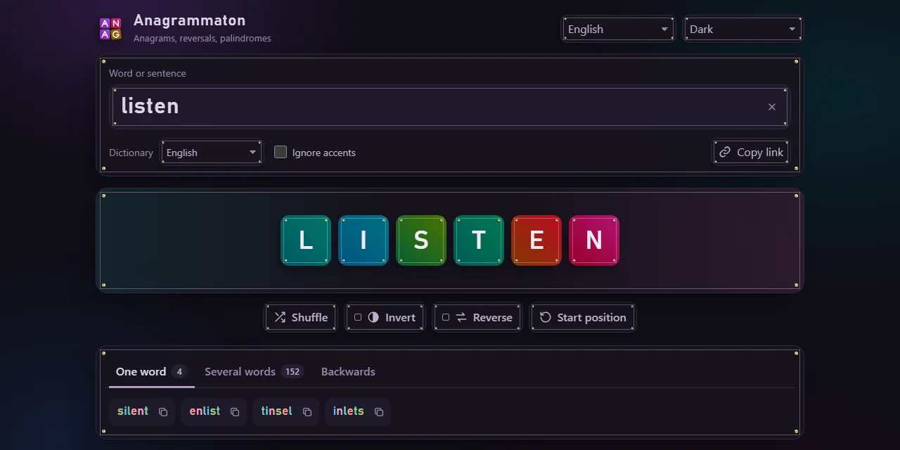

# Anagrammaton

**Anagrams, reversed words and palindromes in 14 languages, without ads or cookies.** Every letter is a coloured tile that flies to its new place when you rearrange. The colour belongs to the letter, so you can follow every R and every E as it moves. Runs in your browser and works offline after the first visit.

   

**Live:** https://dennismit2n.github.io/anagrammaton/ · [Deutsche Fassung](README.de.md)

## What it does

| | |
|---|---|
| **One word** | Every word made of exactly the same letters: “listen” gives “silent”, “enlist” and “tinsel”. |
| **Several words** | Rearrange whole sentences, with limits for word count and minimum length and a word that must appear. The most common results come first. |
| **Backwards** | The reversed text, a palindrome verdict (“Was it a car or a cat I saw”) and reversed words like stressed and desserts. Plus a list to explore for every language. |
| **The stage** | Every unit is a tile with a fixed colour. Click a result and the tiles fly into the new order. |
| **Shuffle, Invert, Reverse** | Shuffle mixes the tiles. Invert flips every colour to its opposite. Reverse turns the order around and runs the colour flow backwards. |
| **Every script** | It counts grapheme units: letters in Latin and Cyrillic, aksharas in Hindi, syllable blocks in Korean, characters in Chinese and Japanese (蜂蜜 and 蜜蜂, 会社 and 社会). |
| **Share it** | The link remembers the word, language, Invert and Reverse. Every result can be copied. |

## Dictionaries

The word lists come from [wordfreq](https://github.com/rspeer/wordfreq) by Robyn Speer, frequency lists built from real texts, so names and rare forms are in there too. Offensive words are filtered with the [LDNOOBW](https://github.com/LDNOOBW/List-of-Dirty-Naughty-Obscene-and-Otherwise-Bad-Words) list. Each language has 23,000 to 69,000 words. Sources and licences are in [woerter/LIZENZ.md](woerter/LIZENZ.md), the build script in `tools/woerter.py`.

## Privacy

- No account, no ads, no cookies, no fonts or scripts from other sites.
- The Content Security Policy only allows requests to the site itself. Only the dictionary of the chosen language is loaded.
- Your word lives in the link, not on your device. Only language and display mode are stored.

## Install and offline

A service worker keeps the page and every dictionary you have used available without a connection. In Chrome, Edge and Samsung Internet an “Install” button appears at the top. On the iPhone use Safari and “Add to Home Screen”.

## Display and languages

Dark by default, plus light, two high contrast modes, two for colour blindness and inverted colours, shared with the other tools of the workshop. Motion is calm, never flashing, and switches off when your system asks for reduced motion. German, English, Spanish, French, Italian, Dutch, Polish, Portuguese, Turkish, Russian, Hindi, Chinese, Japanese and Korean. Some translations are machine made, corrections are welcome.

## Development

No build step, no dependencies. `index.html` holds the interface, styles and texts, `engine.js` the anagram maths (runs in the browser worker and in Node), `worker.js` loads the dictionary and searches in the background. Tests: `node --test tests/`. `tools/` has the word list build script, the icon script and a Playwright test for all 14 languages.

## Licence

Code: [MIT](LICENSE). Word lists: CC BY-SA 4.0, see [woerter/LIZENZ.md](woerter/LIZENZ.md).

© 2026 Dennis_mit_2n · Part of the [workshop](https://dennismit2n.github.io/)
